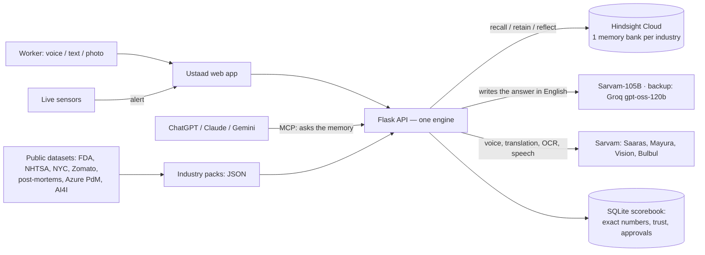

# Ustaad — the expert who never leaves

**When your best expert leaves, their know-how shouldn't.**

Every workplace has a Ramesh: the senior technician, head chef, biomedical engineer, mechanic or principal SRE who just *knows* what to check first. When they retire or quit, that knowledge walks out of the door. Manuals don't have it. Dashboards don't have it.

Ustaad is an AI agent with long-term memory (built on [Hindsight](https://github.com/vectorize-io/hindsight) by Vectorize) that:

1. **Captures** what experts actually do — by voice (12 Indian languages, mixed speech welcome), text or photo.
2. **Recalls** the right fix at the right moment — who did it, when, and how often it worked.
3. **Learns** — every "✔ worked / ✖ didn't work" becomes a new memory, so good fixes rise and bad ones sink.

One engine, five industries: **Factory · Restaurant · Hospital operations · Car garage · IT on-call**. A new industry is one JSON file — no new code.

---

## Why memory is the whole product

| Without memory (generic chatbot) | With Ustaad's Hindsight memory |
|---|---|
| "Check spindle bearings, check lubrication, call the service engineer." | "On 21 Jul Ramesh fixed this: realign the coupling to under 0.02 mm. Two earlier attempts (bearing change, ₹38,000) did **not** work — don't repeat them. Pune plant's twin machine had the same fix." |

The app has a **Memory ON / OFF** switch so you can see this difference live.

### How Hindsight is used

| Hindsight call | Where in Ustaad |
|---|---|
| `create_bank` | One memory bank per industry (`ustaad-factory`, `ustaad-restaurant`, …) with retain/reflect missions written for that industry. |
| `retain` / `retain_batch` | Every work record, expert tip, exit-interview answer, "worked/didn't work" result and public record. Tagged with `asset`, `model`, `type`, `site`, `person`, `outcome`, `code`. |
| `recall` | Each question recalls memories for the same asset **or the same model at another site** (cross-site learning) or the same type, using tags with `tags_match="any"`. |
| `reflect` | Builds SOPs/playbooks: Hindsight reasons over all related memories ("what is the proven way, what failed before?"). |

If no Hindsight key is set, Ustaad falls back to a small built-in **practice memory** with the same interface, so the app always runs. The top bar shows which one is active.



---

## Features

**Core memory engine (every industry)**
- Ask Ustaad — answer with the expert's name, date, sources and how often it worked; cites memories as M1, M2…
- **Only relevant memories are used**: Hindsight finds memories by meaning, a second check re-ranks them by shared words and alarm codes, and the AI must say which memories are about the *same* problem. The trust banner counts only those; the rest fold under "Also searched".
- **Off-topic or unsafe questions** ("capital of France", a medicine dose) get a short "Outside what Ustaad answers" — no fake steps
- **🧠 Patterns Hindsight learned** — Hindsight's own observations (built from many memories) are shown as their own card type
- Memory ON/OFF toggle — generic chatbot vs memory-powered answer, side by side
- Answers with charts — "Which machine lost the most downtime hours?" returns a chart from exact records
- Trust levels on every memory: **Verified** (worked 2+ times / confirmed by 2 people) · **Tested once** · **Unreviewed** · **Didn't work** · **Public record**
- Source panel beside every answer, source badges (ISO 10816, FSSAI, WHO, FDA, NHTSA…)
- "Worked / Didn't work" feedback loop + guided mode (tick each step)
- Flag a wrong memory → Ustaad stops using it
- **The answer is written in English, Sarvam speaks Indian languages:** answers, SOPs, shift reports and interview questions are written in English, then translated by **Sarvam** into any of 12 languages (English, Hindi, Hinglish, Kannada, Tamil, Telugu, Marathi, Bengali, Gujarati, Malayalam, Punjabi, Odia). A question typed in an Indian script is translated to English before memory is searched, and **memory itself stays in English** — so a fix said in Kannada is found by a question asked in Hindi. Machine IDs, codes and numbers are protected through translation.
- AI chain: **Sarvam-105B** writes the structured answer, **Groq** (gpt-oss-120b, very fast) takes over if Sarvam fails or takes longer than 45 s, then a rule-based answer — it never goes silent. `WRITER=groq` swaps the two; a company can also plug in its own AI (see *Bring your own brain*).

**🏭 My machines (every industry: machines, kitchen equipment, hospital devices, vehicles)**
- Add a machine — and let Ustaad fill the form from the maker's **PDF manual**, its **product web page** or a **📷 nameplate photo**
- **Reads like an expert, and checks itself** — see *How Ustaad reads a manual* below: exact tables, parts lists, scanned pages (vision AI), any language; a 🟢/🟠/🔴 colour on every field; a model picker when one document covers many models
- **Ask the manual** — a question box on the machine page answers only from that machine's stored manual pages, with the page number
- **Spec-aware answers** — "spindle max is 8,000 rpm; you were at 8,200" · **👯 Similar machines** · **📅 service dates to your phone calendar** (.ics)
- **📏 Reader accuracy** page — real maker documents with hand-checked answers, scored after unit conversion
- The manual's known faults, alarm codes and service tasks are saved into Hindsight as **📘 Maker's manual** memories
- Answers compare them: **"Manual says … / the team found …"**
- Machine page: 🚦 health light, 🔧 service due (last replacement picked up from the repair history), 📦 spare-parts stock, 🧾 warranty & vendor, full fix history, who knows it best, its manual
- **QR sticker** — print it, stick it on the machine; scanning opens Ask with that machine already chosen
- **Spare parts** — answers warn "Coupling spider: 0 in store, order now"; repair logs that replace a part take one off the stock; the shift report lists what is out
- **📡 Sensor auto-log** — when a sensor crosses its limit, Ustaad opens a half-filled log by itself; the technician only adds what they did. Normal readings after the fix mark it **Sensor-confirmed** (via `POST /api/i/<industry>/sensors/reading`)
- **📞 Ask the expert** — when a fix didn't work, Ustaad names who fixed this before and opens WhatsApp with the message ready

**Capture**
- Smart log: say it in any language, Ustaad auto-tags the asset, problem, cause, result
- **Voice, built like our SIH project:** the recording is cleaned (echo/noise removal, auto volume), stops by itself when you pause, and is turned into a 16 kHz WAV with ffmpeg; then **Sarvam Saaras v4** (auto language detection, mixed Hindi-English-Kannada) → **Google** speech (free) → **Groq Whisper** (last resort). Sarvam gets this industry's own words as hints (machine IDs, alarm codes, people, parts), and "cnc 3" becomes "CNC-3". Every try is logged with its time: `[VOICE-IN] 3F2A | ✅ heard by SARVAM | total 1.3s`. `/api/status` shows the ears in order.
- **🔊 Listen**: answers read aloud with **Sarvam Bulbul** · **Photos** (alarm screen, nameplate, display) and **scanned manual pages** are read by **Sarvam Vision** (OCR for 22 Indian languages + English, tables, handwriting; up to 20 picture pages per document), with Groq's vision AI as the backup: `[OCR] 7C1D | ✅ Sarvam Vision read 12 page(s)`
- **Worker mode**: workers see only Ask, "I fixed something" and Learn; everything else is for seniors and managers
- **"Not sure — search everything"**: workers don't have to pick the right machine; Ustaad also always searches the whole industry and marks results "found on another machine"
- Expert tips with sources · Detailed form
- Senior approval queue — new knowledge is "Unreviewed" until approved
- Role-based access — workers, seniors (can approve), managers

**For managers and experts**
- **ROI dashboard** (the manager's first screen, with a strip on the home page): downtime hours saved, repeat failures avoided, fixed vs failed rate, ₹ saved, monthly MTTR trend
- **Knowledge coverage map**: every machine scored out of 100 (proven fixes for its problems, written-down tips, how many people can fix it, manual added) with red flags like "Only Ramesh knows this machine"
- **Expert leaderboard**: points for fixes that worked and for fixes others reused (credit is linked to the memory that was used), with badges — Top fixer, Most reused, Sharpshooter, Mentor, Rising star

**People**
- Knowledge risk radar — "if Ramesh leaves, these fixes leave with him"
- Before-you-leave interview — questions only about what isn't written down; answers become tips
- Skill map · **Skill passport** with proof levels (Verified / Attested / Self-declared) and a shareable link — credit for experts, so they *want* to share
- Onboarding quiz generated from the team's own past problems
- Shift report built from real data (records, sensor alerts, repeat failures, pending approvals)

**Smart features**
- Live sensor replay → alert → "what fixed this last time?"
- Failure prediction model (gradient boosting, trained on Microsoft's public 100-machine dataset)
- Failure check calculator (rules from 10,000 public machining runs, AI4I 2020)
- Repeat-problem predictor ("returns every ~40 days, next due 8 Dec")
- Cross-site learning (Pune plant ↔ Bengaluru plant, Indiranagar ↔ Koramangala outlets, Bengaluru ↔ Mysuru hospital…)
- Impact & ₹ — time to fix, failed fixes and money, before vs after
- SOP / playbook export (print / save as PDF) · ₹ savings calculator

**Industry tools**
- 🏭 Factory: live sensors, failure prediction, failure check
- 🍛 Restaurant: Zomato complaint data (13.2 lakh reviews scanned), NYC kitchen inspection violations, dish facts
- 🏥 Hospital operations: WHO Surgical Safety Checklist + Neuro OT additions, FDA device reports, **no-diagnosis guard**
- 🚗 Car garage: OBD-II code meanings + team memory, NHTSA owner complaints
- 💻 IT on-call: 240 real public outage write-ups, real log patterns (Loghub)

**Build your own industry** — type "bakery" or "solar farm": Ustaad creates roles, equipment and starter questions with an empty memory, then learns from zero as people log work.

**Easy for a first-time user** — "▶ Try it in 30 seconds" on the home page, a "Start here" role, a grouped menu (Daily work / Team knowledge / For managers), a "What is this?" line on every screen, 3 first-visit hints, and a simple answer page (check first → steps → worked/didn't work; the reasons fold under "Show why").

**Demo guide** — a built-in walkthrough of 6 stories that touches every feature (story 6: a new machine arrives).

---

## Data — honest about what is real

People and companies in the demo are **fictional**. Facts and public data are **real**:

| Data | Used for |
|---|---|
| Team sensor CSV (3 machines) | Live sensor replay (stops before the file's physically impossible values) |
| Microsoft Azure Predictive Maintenance (Kaggle) | Failure-prediction model (8.76 lakh readings) |
| AI4I 2020 (UCI) | Failure check rules |
| Zomato Bangalore reviews (Kaggle) | Customer complaint counts per dish (no review text kept) |
| NYC restaurant inspections (NYC Open Data) | Most common kitchen violations |
| FDA MAUDE via openFDA | 276 real ventilator / infusion-pump malfunction reports |
| NHTSA complaints | 732 real owner complaints (VINs removed) |
| danluu/post-mortems, Loghub | 240 real outages, real log patterns |
| ISO 10816-1, FSSAI, WHO checklist, SAE J2012 | Facts inside expert tips |
| Your own maker manuals / product pages | "My machines" reads them when you add a machine (not stored in this repo) |

Spare-part stock numbers, install and warranty dates for the built-in machines are **demo data** (marked on screen). Last-replaced dates come from the repair history.

**About the model:** it scores AUC 1.0 on held-out months. That is because Microsoft generated this dataset for a tutorial and its failure signals are cleaner than any real plant — we checked for data leakage and found none. Expect lower accuracy on real data. The app says this on screen.

Raw datasets are **not** in this repo (size and licences). See [`data/README.md`](data/README.md) for sources and how to rebuild the small processed files.

---

## Run it locally

```bash
git clone https://github.com/<you>/ustaad.git && cd ustaad && python -m venv .venv && source .venv/bin/activate && pip install -r requirements.txt && cp .env.example .env && python app.py
```
Open http://localhost:5000. Without keys it runs on practice memory with rule-based answers. Add keys to `.env` for the full experience.

## Deploy on Render (manual settings)

1. Push this repo to GitHub. **Never commit `.env`.**
2. Render → New → **Web Service** → pick the repo, then set:
   - Language: **Python 3** · Instance: **Free**
   - Build command: `pip install -r requirements.txt`
   - Start command: `gunicorn app:app --workers 1 --threads 8 --timeout 120 --bind 0.0.0.0:$PORT`
   - Environment variables: `HINDSIGHT_API_KEY`, `GROQ_API_KEY`, `SARVAM_API_KEY` (optional: voice, translation, backup brain), `GITHUB_TOKEN` + `GITHUB_REPO` (optional: auto-save), `PYTHON_VERSION=3.12.7`
   - Health check path: `/health`
3. Load the memories into Hindsight once (about $0.81 of credit), locally with your `.env`:
   `python scripts/seed_hindsight.py --dry-run && python scripts/seed_hindsight.py`

## How Ustaad reads a manual (any link, any PDF, a photo)

Three passes — **find**, **understand**, **check** — so a wrong number is caught by code, not trusted.

1. **Find (no AI).** A web page: its spec tables, its hidden product data (JSON-LD), and up to 3 datasheet/manual PDFs it links to (sites that need JavaScript are read through a page-rendering service). A PDF: every page's text (bronze), then only the useful pages are kept — specs, alarm lists, parts lists, warranty, maintenance (silver). Tables are read cell by cell with their headers (`351FCPG30N — POWER: 53,000 BTU`), parts lists become part name → part number, plain spec lines (`Supply Voltage 380 VAC`) become rows too. Picture-only pages (scans, drawings) are rendered and read by the **Groq vision model** (max 6 per document; type the page numbers to choose which). Password-protected PDFs are reported, not guessed.
2. **Understand (AI).** Identify: maker, model family and *every* model listed — if there are several, you pick yours. Extract: the fields that matter for that kind of machine (a CNC has spindle speed and travels, a compressor has free air delivery and pressure, a fryer has heat input and oil capacity — 16 templates), each with its unit, an exact quote and where it was found. Manuals in other languages are answered in English with the original quote kept.
3. **Check (code).** Every value must appear in the source text; units are converted (hp→kW, cfm→l/min, psi→bar, BTU→kW, kgf/cm²→bar, °F→°C …); values outside a normal range are flagged. 🟢 found in the source · 🟠 not found word-for-word, check it · 🔴 looks wrong · ⚪ not in the source. Without an AI key, step 2 falls back to matching table rows, and step 3 still runs.

All kept pages are stored with the machine (and auto-saved), so **Ask the manual** can quote them later. Known limits: very blurry scans, handwriting and DRM-locked PDFs; the vision model reads at most 6 picture pages per document on the free tier.

**Reader accuracy** (`My machines → 📏 Reader accuracy`): 4 web cases (Kaeser, ELGi spec sheet, BCAS performance sheet, CPG fryer manual) run in the background, and 2 uploaded-file cases (a 211-page VMC manual, the CPG fryer manual) run when that exact file is uploaded — matched by SHA-256, so a different file is never scored against the wrong answer key. Offline, the two file cases score 13/13 from tables and text lines alone.

## Capturing know-how and people

- **📓 Old logbook scanner:** photograph a page of a handwritten register (Hindi or English). Sarvam Vision reads it, the AI splits it into one entry per job (date, machine, problem, what was done, result, who), you tick and fix the rows, and each becomes a memory waiting for a senior's approval. Decades of paper become searchable.
- **🎥 Fix video → guide:** film a repair while explaining it. The *phone* takes a few photos and the sound out of the video (so a big video is never uploaded); Sarvam hears the words in 25-second pieces, the AI writes the steps in the worker's own words, and each step gets the photo from that moment. Saved guides appear on the machine page and their steps go into memory.
- **🧓 Ask one expert's experience:** "Ask Ramesh" answers only from Ramesh's own fixes, labelled *from Ramesh's records — not Ramesh in person*; shows when he is leaving.
- **🎓 Quiz from a machine's manual:** 5 questions from that machine's own manual pages (every answer checked against its page) or, without AI, from its checked specs and service intervals.
- **🛡️ Safety check before risky jobs:** when an answer carries a safety warning, the steps stay locked until the worker ticks the checks (lock-out, gloves and goggles, someone knows) — with a link to the 5-question check for that machine.
- **🧩 Skills matrix:** people × machines from real fixes; **⚠ 1 person** columns show where only one person can fix it, and who is leaving.
- **🔎 Who can fix this?** "hydraulic leak at Pune" → people ranked by proof (fixes that worked, fixes others reused), with the proof, WhatsApp and "Ask their memory".
- **🏅 Evidence-backed skill passport:** every skill links to the fixes that prove it and who confirmed them; ✔ Verified (2+ independent confirmations) / Attested / Self-declared; a skill graph; a share link, a **🔒 private link** (surname and company hidden) and Save as PDF.

## Daily use: hands-free and the morning briefing

- **🎧 Hands-free mode** (Ask screen): one huge button, for oily hands. Speak the problem in your language → Ustaad answers **out loud in the same language** (Sarvam Bulbul): what to do first, the next steps, the safety line. Then two big buttons, ✔ It worked / ✖ It didn't — the result is saved like any other, and if it failed it says who to call.
- **📢 Morning briefing** (Ask screen and Shift report): 30 seconds, spoken, in your language — service due today, parts out of stock, what broke yesterday and is still open, what usually comes back around now, parts near the end of their life. Built from the records with plain rules (no AI needed), then translated by Sarvam.

## Simple for anyone, deep for engineers

The test we design for: **a carpenter who has never seen Ustaad gets it in under a minute**, and an engineer can still see every moving part.

- **First visit:** choose your language from 12 big buttons, then 3 pictures — 🎙️ say the problem → 👷 get your team's fix → ✅ tap "It worked".
- **One big question box:** a huge 🎙️ *Tap and speak* button (it stops when you pause and asks by itself), 📷 photo, or type. Workers see only **Ask · I fixed something · My machines** (a bottom bar on phones); everything else sits under **☰ More tools**.
- **The answer starts with the action:** **👉 Do this first** in big letters, then a tick-off checklist, then two big buttons — **✔ Yes, it worked / ✖ No, it didn't**. The evidence (cause %, memories, manual, what not to repeat) folds under **Why we think so**.
- **Everyday words:** "✔ Worked many times" instead of "Verified"; "Your team has fixed this before — 4 times it worked".
- **The whole screen in your language**, not just the answers: Sarvam translates each label once and Ustaad remembers it for everyone (cached and auto-saved). Company names, people, codes and numbers are never translated.
- **🔊 on every screen** reads it aloud (Sarvam Bulbul) · **A+** bigger text · big touch targets · friendly "Try again" screens.
- **🔬 Engineer mode** (top bar): the service chips, Memory ON/OFF, and under every answer **How this answer was made** — each step with its time (Sarvam → Hindsight near + wide → re-rank → Sarvam writes → translate → cause maths → other plants) plus the raw data.
- **⚙️ /#/system** — live services, models, runtime, test suites, the question flow · **{ } /#/api** — every endpoint with copy-ready examples · footer: *Measured, not claimed*.
- **📲 Installable app (PWA):** "Add to home screen" puts Ustaad on the phone like an app (manifest + service worker; answers are never cached).

## The expert read (machine report, universal profile, part tree)

When a machine gets its manual, Ustaad reads it **the way a senior engineer of that field would**: a CNC manual "as a senior CNC service engineer", a fryer manual "as a commercial-kitchen technician" (16 expert roles). Big manuals are read **section by section in the background, Groq and Sarvam side by side**, then one expert pass writes:

- **Machine report:** what it is, good for / not good for, working window, **what will break first and why**, a daily-weekly-monthly-yearly maintenance plan, critical spares, safety, and **what the manual doesn't say**.
- **Honest labels:** every item carries its page; **📘 Manual** only when code finds the quote on that page, **🧠 Expert conclusion** otherwise. Tap a page and it opens **beside the answer with the quote highlighted** (full screen on phones).
- **Universal profile, 5 layers** (modelled on ISO 14224, the international standard for maintenance data): identity, core ratings, type-specific specs, **part tree** (assemblies → parts, A/B/C criticality), and links (alarm → part). A **completeness %** and **📨 Ask the vendor** (WhatsApp / email) for whatever is missing.
- **Part pages:** part number, spec, interval, failure signs, alarm codes, stock, service due, the manual page, and **the team's real fixes on that part**.
- **Ask the manual** also finds tags on drawings (**"where is relay K1?"**), and **📷 a photo of a panel or part** finds its manual pages (Sarvam Vision reads the photo).
- **Deeper web reading:** a product link also opens the product's other pages on the same site (specs, downloads, spare parts, accessories) and reads spec pictures with Sarvam Vision.

## Smart diagnosis (maths on the team's own records — every number can be explained)

- **🎯 What it usually is:** for a question like "alarm 2041 on CNC-3", Ustaad looks at this team's past cases of the same problem — same machine (weight 1), same model at other sites (0.8), same type (0.4), newer cases counting more — and gives **P(cause)**: "coupling 74%, bearing 16%, something else 10%". A small share is always kept for "something else", so two cases never look certain. It updates every time someone taps Worked / Didn't work.
- **🧠 Smartest order to check:** highest chance **per minute** first (probability ÷ typical time, the classic optimal search order) — with the average time to find the cause this way vs the worst order.
- **⏳ Memories that age honestly:** a fix not re-confirmed for 2 years, or one that failed since, loses trust (and says so on its card); re-confirmed fixes say "✔ re-confirmed 2× since".
- **💸 Cost of not asking Ustaad:** every repair where the team's working fix was already in memory but something else was tried first — hours and ₹ lost, with who knew the fix (machine page + ROI dashboard).
- **🔍 Pattern detective:** all problems, fixes and stops on one timeline, then the rhythms nobody noticed: "comes back every ~49 days", "after the coupling spider was replaced it stayed away 83 days → replace every ~75 days", "this fix looks like the real cure", night-shift and weekday clusters.
- **🚨 Sensor vs the maker's limits:** when the expert read finds a limit ("max 60 °C, p.45"), the sensor alarm uses it and the auto-log quotes it.
- **⏱️ Downtime reasons + uptime %:** "⏹ Log a stop" with a reason (breakdown, waiting for a part, no operator, setup…); a breakdown note becomes a memory. Uptime % and lost hours by reason, per machine.
- **⚙️ Part life by running hours:** an hour-meter reading (typed, or sent by the sensor gateway as `"hours"`) plus part lives from the manual ("replace every 2,000 h") give "1,900 of 2,000 h used" — estimated from the calendar until readings arrive.

## Tests

```bash
pip install -r requirements.txt reportlab
python tests/test_smoke.py && python tests/test_reader.py && python tests/test_voice.py && python tests/test_backup.py
```
Offline — the AI, Hindsight, GitHub and the internet are replaced by fakes. The reader tests cover web tables + product data, a PDF model table and parts list, the model picker, a scanned page read by (fake) vision, an invented value caught as 🟠, a silly value flagged 🔴, unit conversion, link safety, Ask the manual, the calendar file and the accuracy scorer.

## For other AI agents (API)

Ustaad's memory can be used by other agents, not only people. Every screen is a plain JSON API, for example:

```bash
curl -s -X POST https://<your-app>.onrender.com/api/i/factory/ask -H "Content-Type: application/json" -d '{"asset_id":"CNC-3","problem":"alarm 2041 whistling at high rpm"}'
```
Main endpoints: `/api/industries`, `/api/i/<industry>/ask`, `/feedback`, `/smart-log`, `/memories`, `/playbook`, `/risk`, `/passport/<person>`, `/stats`, `/api/packs/custom`, `/api/i/<industry>/machines/read` (link, PDF, photo or text → checked specs), `/machines/<id>/ask-manual`, `/machines/<id>/service.ics`, `/api/benchmark`.

### Ustaad for other AIs (MCP server + one file per machine)

- **MCP server** at `/mcp` (Streamable HTTP, JSON-RPC 2.0). Any AI assistant that supports MCP can add it as a connector:
  ```json
  {"mcpServers": {"ustaad": {"type": "http", "url": "https://<your-app>.onrender.com/mcp"}}}
  ```
  7 tools: `ask_ustaad`, `search_memory`, `list_machines`, `machine_summary`, `cause_chances`, `find_expert`, `morning_briefing`. Step-by-step for people: the **🤖 Connect your AI** page.
  Optional lock: set `MCP_TOKEN` on Render; clients then send `Authorization: Bearer <token>`.
- **One readable file per machine:** `/machines/<industry>/<id>.md` — specs, expert report, service due, spare parts, fixes that worked, what didn't, who knows it best.
- **`/llms.txt`** — what Ustaad is and where everything is, for AI assistants.

## Stage 6: connected to the outside

- **🏭 The machine calls first.** When a sensor reading crosses its limit (the maker's own limit when the manual gives one), Ustaad opens the case by itself, works out from the team's records what this alert usually is, picks the best person to call (their own fixes of it, fixes of theirs others reused, same site counts double) and what worked last time. A **red bar** appears on top of every screen — *🚨 CNC-3 is calling — high vibration, 7 mm/s (limit 4.5) · Best person: Ramesh Gowda* — with a ready WhatsApp message and **📞 Call** (when a phone number is in the people list). It is also the first line of the morning briefing. Live sensors → **🚨 Test alert** shows it in one tap.
- **🌐 Plants learning from each other.** Under every answer: *In other plants — 19 cases of "Spindle vibration" from 9 plants with the same HMC-500: realigning the coupling worked 11 of 12 times; replacing the bearing 2 of 5.* Matched by the same model first, then the same type. Every plant can share its own results (on by default, switch in engineer mode); **names, the company and places are removed** before anything is shared. In this demo the other plants are **sample data** (`data/network.json`), clearly labelled.
- **🤖 Connect your AI** (footer and More menu): copy the link, paste it into Claude, ChatGPT or Gemini, then ask in plain words. A **Test** button does the same 3 steps an AI does (hello → menu → one question). A new tool, `search_memory`, gives other AIs the team's raw cases (who, what, when, worked or not) so *they* write the answer — no second AI in between.
- **🧠 Bring your own brain** (optional). Sarvam writes by default. A company that must use its own AI sets four server settings — memory, maths, voice and translation stay exactly the same:

  | Setting | Example |
  |---|---|
  | `BRAIN_URL` | `https://api.openai.com/v1` · Gemini's OpenAI-style address · `http://<server>:11434/v1` (own model with Ollama) |
  | `BRAIN_KEY` | the key from that AI (empty for an own server without a key) |
  | `BRAIN_MODEL` | e.g. `gpt-4o-mini`, `gemini-2.5-flash`, `llama3.1` |
  | `BRAIN_NAME` | how the app shows it, e.g. `ChatGPT` |

  Any AI that accepts OpenAI-style chat requests works. Remove the settings to go back to Sarvam. The System page shows who is writing.

## Reading the Render logs

Every feature writes one clear line (Render → your service → **Logs**). Keys are never written — anything that looks like a key is shown as `***`.

| Tag | What it tells you |
|---|---|
| `[START]` | What is switched on: memory, Groq ✓/✗, Sarvam ✓/✗, ffmpeg, auto-save, MCP |
| `[REQ]` | Every API call: path, status, time — and the error message if it failed |
| `[ASK]` | Machine, language, memories used, who wrote the answer, trust, top cause, time |
| `[MEMORY]` | Hindsight recall/save — or that it fell back to practice memory, and why |
| `[AI]` | Each Groq / Sarvam call: ok or FAILED with the reason |
| `[VOICE-IN]` / `[VOICE-OUT]` | Who heard the speech (Sarvam → Google → Groq) / Sarvam speaking |
| `[TRANSLATE]` `[OCR]` `[READ]` `[EXPERT]` | Translation, Sarvam Vision, manual reading, the expert read |
| `[FEEDBACK]` `[LOG]` `[LOGBOOK]` `[VIDEO]` `[BRIEF]` `[MCP]` `[ALERT]` `[NETWORK]` `[BACKUP]` | Worked/didn't, logs and tips, scanned registers, fix videos, the briefing, other AIs, auto-save |
| `[ERROR]` | Anything that crashed, with the page it happened on |

Search the logs for `FAILED` or `[ERROR]` to find problems fast.

## Auto-save (data survives restarts and redeploys)

Everything people add on the live site — machines, work logs, tips, approvals, spare-part stock, flags, sensor states and custom industries — is saved a few seconds later to **one JSON file on a separate branch** (`ustaad-data`, file `ustaad-backup.json`) of your own repo, and loaded back when the server starts. Your code branch stays clean. The top bar shows **💾 Auto-save on**.

Set on the server (never in code): `GITHUB_TOKEN` — a fine-grained token for this one repo with **Contents: Read and write** — and `GITHUB_REPO` (e.g. `you/your-repo`). Safety: if the saved file can't be loaded at start, saving pauses (the chip says *paused*) so a network hiccup can never overwrite good data with an empty copy. Without these variables the app works exactly as before. If your repo is public, this file is public too — it holds demo data only, never keys.

## Sensor readings API

A factory's sensor gateway (or a PLC script) can post live readings:

```bash
curl -s -X POST https://<your-app>.onrender.com/api/i/factory/sensors/reading -H "Content-Type: application/json" -d '{"asset_id":"CNC-3","vib":2.1,"temp":41}'
```
A reading above the limit opens an auto-log. After a technician reports the fix as worked, three normal readings in a row mark it **Sensor-confirmed**. (The demo's sensor file stops at the fault, so on the demo it shows "waiting for normal readings".)

## Scaling

- **New customer** = a new Hindsight bank (`<prefix>-<industry>` → per company/site). No code change.
- **New industry** = one pack file in `data/packs/` (assets, people, roles, starter memories, panels).
- The API keeps no state between requests → run more copies. Move SQLite → Postgres for real customers; Hindsight handles the heavy memory/search work as a managed service.
- Privacy: India's DPDP Act — consent, anonymised records, hospital mode limited to equipment/process knowledge.
- **Where data lives:** knowledge (every log, result, tip, manual fact) → **Hindsight Cloud** (permanent). Exact lists and numbers (machines, stock, approvals, flags) → a local SQLite "scorebook" for speed, plus **auto-save** to your GitHub repo (below), because free hosting wipes the server's disk on every deploy. For real customers: Postgres.

## Next (not built yet)

Offline mode for low-network shop floors (queued logs) · WhatsApp bot · one memory bank per customer company.

## Project layout

```
app.py                  Flask API + static frontend
ustaad/                 engine: memory (Hindsight), agent, insights, store, packs, llm
  reader.py             reads links, PDFs (tables, parts lists, scans), photos → pages + exact rows
  specs.py              machine-type templates, identify → extract → check, unit conversion
  benchmark.py          reader accuracy cases with hand-checked answers
data/packs/*.json       one file per industry
data/processed/*.json   small files built from public datasets
static/                 frontend (plain JS, built-in SVG charts, no build step)
scripts/                dataset processing, model training, pack building, Hindsight seeding
tests/                  smoke tests
```

Links: [Hindsight on GitHub](https://github.com/vectorize-io/hindsight) · [Hindsight docs](https://hindsight.vectorize.io/) · [What is agent memory](https://vectorize.io/what-is-agent-memory)
